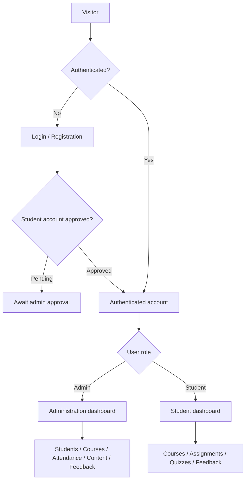

<div align="center">

# 🎓 LMS — Learning Management System

### A Laravel-powered platform for academic administration, learning workflows, and student engagement.

[](https://laravel.com/)
[](https://www.php.net/)
[](https://tailwindcss.com/)
[](https://vite.dev/)
[](https://github.com/AdityaGit8009/lms-laravel)

**[Source Code](https://github.com/AdityaGit8009/lms-laravel)** · **[Report an Issue](https://github.com/AdityaGit8009/lms-laravel/issues)** · **[Developer](https://github.com/AdityaGit8009)**

</div>

---

## 📖 Overview

**LMS (Learning Management System)** is a web application built with **Laravel 12** to support educational administration and student-facing learning activities. The repository includes routes and controllers for managing academic structures, students, employees, attendance, learning content, assessments, feedback, and notifications.

The platform has distinct **administrative** and **student** interfaces. Its registration workflow includes administrative approval for self-registered student accounts, as described in the repository's `README_FIX.txt`.

> **Project note:** This README documents modules and workflows evidenced by the repository's routes, dependencies, and fix notes. The presence of a page or route does not guarantee that every workflow is feature-complete or production-tested.

## ✨ Project Modules

| Area | Repository-backed functionality |
| --- | --- |
| 🔐 Authentication | Login, registration, authenticated dashboards, student approval status |
| 🧑‍💼 Administration | Admin dashboard, profiles, password change, roles, settings |
| 👩‍🎓 Student management | Student records, assignments, bulk import templates, blocked/deleted student views, login-status logs |
| 👨‍🏫 Employee management | Employee records, batch assignments, bulk-upload and registration-ID templates |
| 🏫 Academic configuration | Sessions, programmes, technologies, batches, centers, branches, subjects, and subject topics |
| 📚 Learning content | Course pages, content upload, content bundles, and topic-based content |
| 📝 Assessments | Subject mock tests and student quiz/results pages |
| 📅 Attendance | Attendance entry, attendance reports, bulk templates, and QR-attendance page |
| 📣 Communication | Announcements, notifications, popup notifications, and notification categories |
| 💬 Feedback | Admin feedback forms, student responses, and feedback analytics |
| 📊 Student portal | Dashboard, courses, assignments, quizzes, schedule, results, certificates, profile |

## 🧰 Technology Stack

| Layer | Technology |
| --- | --- |
| Backend | PHP 8.2+, Laravel 12 |
| Authentication/API tooling | Laravel authentication middleware, Laravel Sanctum dependency |
| Frontend | Laravel Blade/resources, Tailwind CSS 4 |
| Asset pipeline | Vite 6, `laravel-vite-plugin` |
| HTTP client/tooling | Axios |
| Database | Laravel database layer; SQL dump `lms_fixed.sql` included (configure the actual database in `.env`) |
| Tests and code quality | PHPUnit, Laravel Pint |
| Dependency managers | Composer, npm |

## 🏗️ Application Flow



> The flow is a conceptual overview. Route-level authorization and middleware should be independently reviewed before production deployment.

## 📁 Repository Structure

```text
lms-laravel/
├── app/                 # Application logic, controllers, models, middleware
├── bootstrap/           # Laravel bootstrap files
├── config/              # Framework and application configuration
├── database/            # Migrations, seeders and factories
├── lms/                 # Additional project directory
├── public/              # Web entry point and public assets
├── resources/           # Frontend templates and assets
├── routes/              # Web/application routes
├── storage/             # Logs, cache and uploaded/generated files
├── tests/               # Automated tests
├── artisan              # Laravel command-line entry point
├── composer.json        # PHP packages and Laravel requirements
├── package.json         # JavaScript packages and Vite scripts
├── vite.config.js       # Frontend build configuration
├── lms_fixed.sql        # Included database SQL dump
├── README_FIX.txt       # Repository-specific login and database fix notes
└── README.md            # Project documentation
```

## 🚀 Local Installation

### Prerequisites

- PHP **8.2 or newer** with extensions required by Laravel and the selected database
- [Composer](https://getcomposer.org/)
- Node.js and npm (compatible with Vite 6)
- A configured database server, if using the supplied SQL dump
- Git

### 1. Clone the repository

```bash
git clone https://github.com/AdityaGit8009/lms-laravel.git
cd lms-laravel
```

### 2. Install PHP dependencies

```bash
composer install
```

### 3. Create and configure the environment file

The repository listing does **not** currently show an `.env.example` file. If one exists in your checkout, copy it. Otherwise, create a local `.env` using the settings required by your application and deployment environment. Configure at least `APP_NAME`, `APP_ENV`, `APP_URL`, and the appropriate `DB_*` variables.

**Example database configuration for a local MySQL installation:**

```dotenv
APP_NAME="LMS"
APP_ENV=local
APP_DEBUG=true
APP_URL=http://127.0.0.1:8000

DB_CONNECTION=mysql
DB_HOST=127.0.0.1
DB_PORT=3306
DB_DATABASE=lms
DB_USERNAME=root
DB_PASSWORD=
```

This is a **sample**, not a copy of the repository's actual environment settings. Use credentials for your own database. Ensure your `.env` also contains the standard Laravel configuration required by your application.

### 4. Generate the application key

```bash
php artisan key:generate
```

### 5. Set up the database — choose one path

**Option A — migrations** (recommended for an empty database when migrations are complete):

```bash
php artisan migrate
```

**Option B — included SQL dump** (for a compatible database): import `lms_fixed.sql` using your database client. The repository's `README_FIX.txt` lists this as an alternative to migrations. **Do not automatically run migrations on top of an imported dump without checking table/schema compatibility and making a backup.**

### 6. Install frontend dependencies

```bash
npm install
npm run dev
```

Keep this terminal running for local Vite asset serving. For a built asset bundle instead, use `npm run build`.

### 7. Clear caches and start the application

In another terminal:

```bash
php artisan optimize:clear
php artisan serve
```

Open **http://127.0.0.1:8000** and navigate to the login page.

## 🔑 Login and Student Approval Workflow

According to `README_FIX.txt` in this repository:

1. Login uses the `users` table.
2. Admin users authenticate with their email and password from that table.
3. Students created by an admin are marked `role=student` and `approval_status=Approved`.
4. Self-registered students receive `approval_status=Pending`.
5. Pending students must be approved before they can log in.
6. Admin approval updates both `tbl_register` and `users.approval_status`.

**No default admin credentials are documented here.** Create or use an authorized account according to your local database and application configuration.

## 🧭 Key Pages

| Path | Purpose |
| --- | --- |
| `/login` | User sign-in |
| `/register` | Registration |
| `/dashboard` | Administrative dashboard route |
| `/students` | Student management |
| `/employees` | Employee management |
| `/courses` | Course management |
| `/view-attandence` | Attendance reporting (route spelling as implemented) |
| `/qr-attendance` | QR-attendance interface |
| `/upload-content` | Educational content upload |
| `/subject-mocktest` | Subject mock test administration |
| `/admin/feedback/manage` | Feedback management |
| `/admin/feedback/overall-analytics` | Feedback analytics |
| `/student/dashboard` | Student dashboard |
| `/student/courses` | Student courses |
| `/student/quiz` | Student quiz page |
| `/student/feedback` | Student feedback |

Routes may require authentication and additional middleware.

## 🧪 Testing and Useful Commands

```bash
# Show available routes
php artisan route:list

# Run tests
php artisan test

# Clear application caches
php artisan optimize:clear

# Format PHP code (if desired)
./vendor/bin/pint

# Build production assets
npm run build
```

Test results and full feature completion have not been independently verified.

## 🔒 Security & Deployment Checklist

Before exposing the application on a public server:

- Set `APP_ENV=production` and `APP_DEBUG=false`.
- Keep `.env`, database credentials, and application keys out of version control.
- Review all admin and student routes for **server-side role authorization**; authentication alone is not sufficient.
- Validate file uploads, CSV imports, input data, and access to student records.
- Use HTTPS and properly configure session cookies and file permissions.
- Review the included `lms_fixed.sql` for personal or sensitive data before sharing or importing it.
- Verify migrations, backups, dependencies, and tests.
- Configure the web server to use Laravel's `public/` directory as the document root.

## 🗺️ Suggested Next Improvements

- [ ] Audit role-based authorization throughout admin/student pages
- [ ] Expand automated tests for registration, approval, attendance, and assessments
- [ ] Add sample screenshots for admin and student dashboards
- [ ] Provide a safe, sanitized `.env.example`
- [ ] Document database migrations and test data seeding
- [ ] Add CI checks for tests, linting, and dependency vulnerabilities
- [ ] Publish a verified production deployment guide

## 👨‍💻 Developer

**Aditya Pratap Vishwakarma**

- **GitHub:** [@AdityaGit8009](https://github.com/AdityaGit8009)
- **LinkedIn:** [vish-aditya](https://www.linkedin.com/in/vish-aditya/)
- **Email:** [adityapratap7391@gmail.com](mailto:adityapratap7391@gmail.com)

## 🤝 Contributing

Suggestions, bug reports, and improvements are welcome through [GitHub Issues](https://github.com/AdityaGit8009/lms-laravel/issues). When contributing, please include a clear description, reproducible steps for bugs, and relevant tests where practical.

## 📄 License

The repository's `composer.json` declares an MIT license for the Laravel application skeleton. **Check project ownership and third-party assets before assuming the entire custom LMS codebase is licensed for reuse.** Add a top-level `LICENSE` file if you intend to publish a specific project license.

---

<div align="center">

**Built with Laravel · Designed for educational workflows**

⭐ If you find the project helpful, consider starring the repository.

</div>
